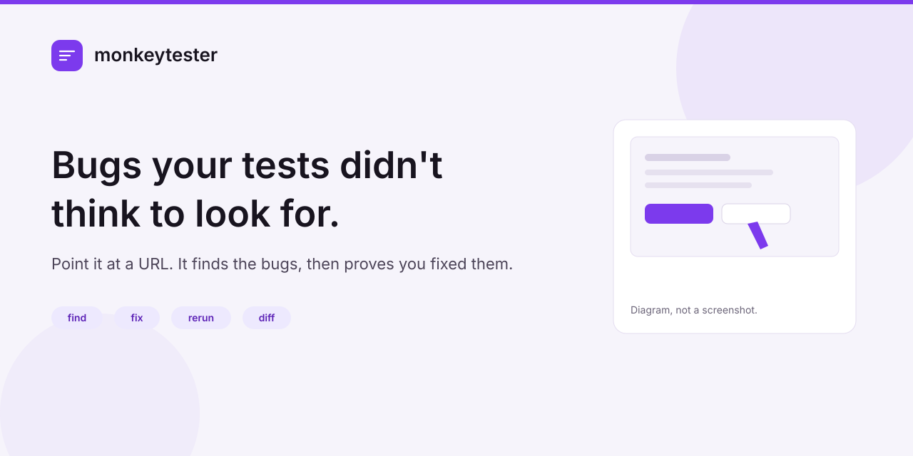
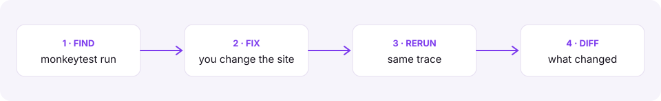

<p align="center">
  <picture>
    <source media="(prefers-color-scheme: dark)" srcset="docs/public/banner-dark.svg" />
    
  </picture>
</p>

<h1 align="center">Bugs your tests didn't think to look for.</h1>

<p align="center">
  Point it at a URL. It finds the bugs, then proves you fixed them.<br />
  Open source. Playwright and your LLM. Node.js 20+.
</p>

<p align="center">
  <a href="https://www.npmjs.com/package/@monkeytestai/monkeytester"></a>
  <a href="https://nodejs.org/"></a>
  <a href="https://docs.monkeytest.ai"></a>
  <a href="https://github.com/monkeytestai/monkeytester/actions/workflows/ci.yml"></a>
  <a href="https://github.com/monkeytestai/monkeytester/blob/main/LICENSE"></a>
</p>

<p align="center">
  <a href="https://docs.monkeytest.ai/getting-started/quick-start">Quick start</a> ·
  <a href="https://docs.monkeytest.ai/guides/how-is-this-different">How is this different?</a> ·
  <a href="https://docs.monkeytest.ai/reference/cli">CLI</a> ·
  <a href="https://docs.monkeytest.ai/guides/llm-providers">LLM providers</a> ·
  <a href="https://monkeytest.ai">Cloud</a>
</p>

Open-source autonomous website QA. Pass a URL to the CLI or the library. It explores with Playwright, files findings that carry evidence, and — when a trace was stored — replays that same plan with `rerun` and compares fingerprints with `diff`.

It is an AGPL-3.0 TypeScript CLI and library. The command is `monkeytest`. It is not a hosted REST API and it does not ship an MCP server. Programmatic use is a normal import.

A flow is `passed` only when its outcome check verifies. Unfinished checks stay `inconclusive`. Coverage is what the crawl reached under the depth cap, not the whole site. Confirm a filed bug on the site before you treat the run as the whole story. Contact, enquiry, feedback, support, quote, and get-in-touch messages are not sent. Password reset, OTP, newsletter, payment, and account deletion stay blocked unless you opt in with your own inbox, or with `allowSensitive` where the engine already allows it. There is no hosted inbox.

The accuracy gate — false positives under 10% on a fixed 10-site set — has not been measured. A 0% note on two sites is not that gate. See [Quality methodology](https://docs.monkeytest.ai/guides/quality).

npm dist-tag `latest` is the stable channel (`npm install @monkeytestai/monkeytester`). npm dist-tag `next` is the pre-release channel. This checkout's version is `package.json`, printed by `monkeytest version`. It is not the hosted product. A registry check on 8 Nov 2026 at 10:16 IST reported `latest` 0.7.1 and `next` 0.7.2-beta.2. That observation is not a pin. The hosted API and worker were observed running 0.7.0 from droplet checkout `60def87b`. The image revision is unproven, and unset safety flags do not establish safety defaults. An npm tag is not that deployment. [Versions](https://docs.monkeytest.ai/getting-started/versions).

## Quick start

### 1. npx

```bash
npx --yes @monkeytestai/monkeytester@latest --help
```

That prints the commands. It does not need an API key or a browser.

### 2. Install

```bash
npm install @monkeytestai/monkeytester
npx playwright install chromium
```

pnpm, yarn, and bun install the same package (`pnpm add`, `yarn add`, `bun add`). Playwright downloads its own Chromium. Node.js 20 or newer. You bring a model: OpenAI, Gemini, Anthropic, Mistral, Groq, or any OpenAI-compatible endpoint (Ollama, vLLM, LM Studio, OpenRouter). The stable install follows npm `latest`. For the pre-release channel:

```bash
npm install @monkeytestai/monkeytester@next
```

### 3. First run

```bash
export OPENAI_API_KEY="sk-..."
npx monkeytest run https://example.com --depth basic
```

With an OpenAI key, the default model is `gpt-4o-mini`. If several keys are set, auto-detect uses the first of: `GEMINI_API_KEY` or `GOOGLE_API_KEY`, `OPENAI_API_KEY`, `ANTHROPIC_API_KEY`, `MISTRAL_API_KEY`, `GROQ_API_KEY`, then `OPENAI_COMPATIBLE_BASE_URL`.

`--depth basic` is Quick pass: 6 pages, 5 LLM flows, page checks outside that budget, and a 120 second cap. About 10 cases, usually 1–2 minutes. `--max` and `--flows` override the page and flow caps. Dollar figures for a larger standard run are a sketch in [Cost and depth](https://docs.monkeytest.ai/guides/cost-and-depth). Quick pass is smaller than that sketch. They are not an invoice. A missing key exits 2 before Chromium starts.

### 4. Read the report

```bash
npx monkeytest report
npx monkeytest open
```

`open` is unreleased in this source tree. The npm packages observed on 8 Nov 2026 do not include it.

`report` prints the run. `open` prints the absolute path of that file and the screenshot and WebM paths stored on it. It does not upload them and it does not open the site. There is no hosted report URL.

| Path | What it is |
| --- | --- |
| `.monkeytest/plan.json` | The plan. `rerun` replays its trace. |
| `.monkeytest/runs/<id>.json` | The run: flows, bugs, outcome. |
| `.monkeytest/shots/` | Page and step PNGs, and one WebM per flow. |

Exit `0` when no blocking bug remains (`minor` does not fail the process). Exit `1` when `run` or `rerun` found a blocking bug, when `diff` found a new or more severe bug, or when `verify` still sees a bug firing. Exit `2` is bad arguments or no provider. Exit `3` is an engine error, including a crawl that opened no pages.

## Demo

> **Not a recording.** The figure below is a diagram of the loop. It is not a captured session.

A find → fix → same-trace rerun → diff on the local demo fixture is in [examples/fixture-loop](./examples/fixture-loop/README.md). The plan is hand-authored and the action resolver is a stub. `examples/fixture-loop/artifact.json` is that stub run, stamped with the engine version. It is not a live model and not a customer site. A real-model recording is blocked: this tree was not given a model credential, and the stub artifact is not that proof. The diagram above stays a diagram.

<p align="center">
  
</p>

## What you get

Page checks run without a model call. The five are console errors, same-site failed requests and broken links, axe-core WCAG A/AA, mobile overflow and tap targets at 375px, and title / description / lang / viewport / h1. Serious or critical axe violations are bugs. A flow is `passed` only when its outcome check verifies. No check is `inconclusive` with reason `no_assertion`. A check that cannot be decided is `assertion_unverifiable`.

The contributor smoke script is a **stub**, not real-model testing. It does not call a provider. It crawls `https://example.com`. From a clone, after `npm run build` and `npx playwright install chromium`:

```bash
node scripts/smoke.mjs
```

This is the output of `node scripts/smoke.mjs` on this repository after `npm run build`. The duration is from that run.

```text
STUB — not real-model testing. No API key is read. The crawl target is https://example.com.
  · visited https://example.com/ — Static placeholder page used as the canonical example domain.

[explore] done in 1.1 s
  pages: 1 failures: 0
  siteType: placeholder

[plan] flows: 6
  - [happy_path] Visit the example.com homepage (2 steps)
  - [visual] Console errors on load (1 steps)
  - [visual] Broken requests and links (1 steps)
  - [accessibility] WCAG A and AA (1 steps)
  - [visual] Mobile layout (1 steps)
  - [accessibility] Page metadata (1 steps)

OK — engine pipeline is wired correctly.
STUB — this success line is not a real-model result.
```

When one confirmed bug is filed, the engine's `outcome_detail` is this sentence (asserted by the outcome tests, not a sample report):

```text
Found 1 confirmed bug. Open the top one and confirm it on the site before treating this run as healthy.
```

On a login-only crawl (`public_screens` is `0`) the same case says deeper journeys need an account, and `outcome_reason` is `login_required`.

## How is this different?

| | What it is | Who supplies the goal | What you keep |
| --- | --- | --- | --- |
| **monkeytester** | Open-source CLI and library for autonomous website QA | A URL. The crawl, the planner, and the page checks propose cases | Evidence-backed bugs, a stored plan, `rerun` of that plan, fingerprint `diff` |
| **[Playwright Test](https://playwright.dev/docs/intro)** | An end-to-end framework for tests you own | You, or [Playwright Test Agents](https://playwright.dev/docs/test-agents), which plan, generate, and heal Playwright tests | Test files and their report |
| **[browser-use](https://github.com/browser-use/browser-use)** | Open-source browser-agent infrastructure | A task you give the agent. The agent can inspect the page while doing that task. That is discovery in service of the task | The task result |
| **Recorders and other scripted QA tools** | Session capture or a script you wrote | You, by recording or writing the steps | A replay of those steps |

A pass requires a verified outcome check, otherwise the result is `inconclusive`. `monkeytest rerun` replays the stored trace, and `monkeytest diff` compares fingerprints. This table is not a score. More on the [comparison page](https://docs.monkeytest.ai/guides/how-is-this-different).

## Find, fix, rerun, diff

```bash
npx monkeytest run https://example.com --depth basic
# you ship a fix
npx monkeytest rerun
npx monkeytest diff prev latest
```

`rerun` replays the action trace and does not call the LLM. `--heal` may call the model when a stored locator misses. Runs saved before traces existed fall back to re-executing the plan with the LLM. `diff prev latest` compares the previous run to the newest one. The printer's line is `N new, N fixed, N still broken, N regressed (net ±N)`. It exits 1 when a bug is new or more severe.

`monkeytest verify` replays each known bug and prints `fixed`, `still_broken`, `flaky`, `healed`, or `blocked`.

On a TTY, `diff` or `verify` may print one star link — https://github.com/monkeytestai/monkeytester — only when the run being judged has `finishedAt`, `outcome` `clean`, and no bugs left, and the diff or verify signal is a real fix (every verdict `fixed`, or at least one fixed bug and nothing new, persisting, or regressed). `inconclusive`, `could_not_test`, `bugs_found`, an unknown outcome, and a missing `finishedAt` do not ask, even if a stale diff says everything is fixed. A loopback URL does not ask. A run whose stored `warnings`, step errors, or bug text already name a stub provider (`[stub · …]`) does not ask, including when the URL is not loopback. The one-time marker is `.monkeytest/.star-noted` and contains the word `noted`. Nothing is sent. Set `MONKEYTEST_NO_STAR=1` or pass `--no-star` to skip it. CI, `--json`, and a non-interactive stdout stay quiet. A star is not a usage metric, and neither are npm downloads.

The same loop from the library:

```ts
import { Monkey, autoLLMConfig, savePlan, saveRun, loadPlan, diffRuns } from '@monkeytestai/monkeytester';

const monkey = new Monkey({ llm: autoLLMConfig({ quality: 'balanced' }) });
const { plan, run: first } = await monkey.executeAndTriage('https://example.com', {
  run: { screenshotsDir: '.monkeytest/shots' },
});
savePlan(plan, { dir: '.monkeytest' });
saveRun(first, { dir: '.monkeytest' });

const stored = loadPlan('.monkeytest');
const { run: second } = await monkey.runFromPlan(stored.plan, {
  run: { screenshotsDir: '.monkeytest/shots' },
});
saveRun(second, { dir: '.monkeytest' });
console.log(diffRuns(first, second).stats);
```

## CI

`run` already exits 1 on a blocking bug, so the job fails without a wrapper. Pass your preview URL in. The step below does not wait on a host for you.

```yaml
name: monkeytest
on: [workflow_dispatch]
jobs:
  monkeytest:
    runs-on: ubuntu-latest
    steps:
      - uses: actions/setup-node@v4
        with:
          node-version: 20
      - run: npm install @monkeytestai/monkeytester
      - run: npx playwright install --with-deps chromium
      - run: npx monkeytest run "$PREVIEW_URL" --depth basic
        env:
          PREVIEW_URL: https://example.com
          OPENAI_API_KEY: ${{ secrets.OPENAI_API_KEY }}
```

Upload `.monkeytest/shots/` and `.monkeytest/runs/` as artifacts when you want the evidence. The longer recipe is in the [CI guide](https://docs.monkeytest.ai/guides/ci).

## LLM providers

One provider per phase, or the same one everywhere. `autoLLMConfig({ quality: 'balanced' })` uses the cheap model for explore and run, and the smart model for the single planning call.

| Provider | Flag | Key | Cheap model | Smart model |
| --- | --- | --- | --- | --- |
| OpenAI | `openai` | `OPENAI_API_KEY` | `gpt-4o-mini` | `gpt-4o` |
| Gemini | `gemini` | `GEMINI_API_KEY` or `GOOGLE_API_KEY` | `gemini-flash-lite-latest` | `gemini-flash-latest` |
| Anthropic | `anthropic` | `ANTHROPIC_API_KEY` | `claude-haiku-4-5` | `claude-sonnet-4-5` |
| Mistral | `mistral` | `MISTRAL_API_KEY` | `mistral-small-latest` | `mistral-large-latest` |
| Groq | `groq` | `GROQ_API_KEY` | `llama-3.3-70b-versatile` | `llama-3.3-70b-versatile` |
| OpenAI-compatible | `openai_compatible` | `OPENAI_COMPATIBLE_BASE_URL` | `gpt-4o-mini` | `gpt-4o` |

Ollama, vLLM, LM Studio, and OpenRouter use `openai_compatible` and `--base-url`. Model ids are the defaults in `CHEAP_FAST_MODEL` and `SMART_MODEL`. Details, including a local Ollama command: [LLM providers](https://docs.monkeytest.ai/guides/llm-providers).

## Docs

[docs.monkeytest.ai](https://docs.monkeytest.ai)

- [Quick start](https://docs.monkeytest.ai/getting-started/quick-start)
- [Your first run](https://docs.monkeytest.ai/getting-started/first-run) and [reading the report](https://docs.monkeytest.ai/getting-started/reading-the-report)
- [How is this different?](https://docs.monkeytest.ai/guides/how-is-this-different)
- [Rerun and diff](https://docs.monkeytest.ai/guides/rerun-and-diff)
- [Auth and login-only sites](https://docs.monkeytest.ai/guides/auth)
- [Sign-up testing with your own inbox](https://docs.monkeytest.ai/guides/signup)
- [Cost and depth](https://docs.monkeytest.ai/guides/cost-and-depth)
- [CLI](https://docs.monkeytest.ai/reference/cli), [config](https://docs.monkeytest.ai/reference/config), [API](https://docs.monkeytest.ai/reference/api), [report fields](https://docs.monkeytest.ai/reference/report)
- [Versions](https://docs.monkeytest.ai/getting-started/versions), [quality methodology](https://docs.monkeytest.ai/guides/quality)

Hosted runs are a separate service at [monkeytest.ai](https://monkeytest.ai). The observed API and worker version is not the npm tag. See [Versions](https://docs.monkeytest.ai/getting-started/versions).

## Contributing

Issues and pull requests are welcome. Read [CONTRIBUTING.md](./CONTRIBUTING.md), the concrete briefs in [STARTER_ISSUES.md](./.github/STARTER_ISSUES.md), and [CODE_OF_CONDUCT.md](./CODE_OF_CONDUCT.md). Report vulnerabilities in private using [SECURITY.md](./SECURITY.md). Recommended GitHub About text and topics, which this pull request does not apply, are in [REPOSITORY_METADATA.md](./.github/REPOSITORY_METADATA.md).

## License

[AGPL-3.0-only](./LICENSE). `SPDX-License-Identifier: AGPL-3.0-only`. You can run and self-host it. If you modify the engine and serve that modification as a network service, the Affero terms apply. Summary: [License](https://docs.monkeytest.ai/guides/license).
